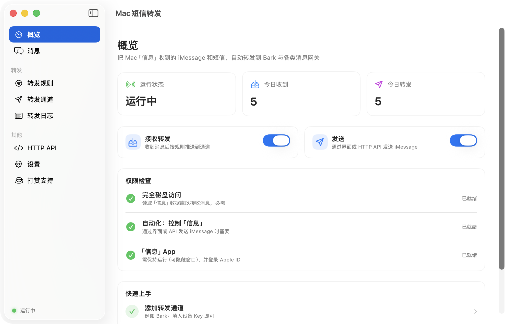
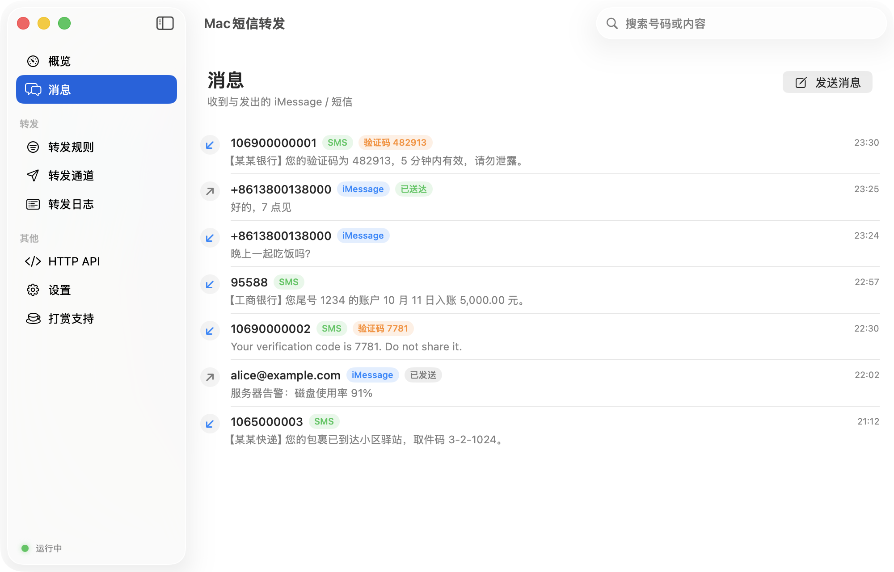
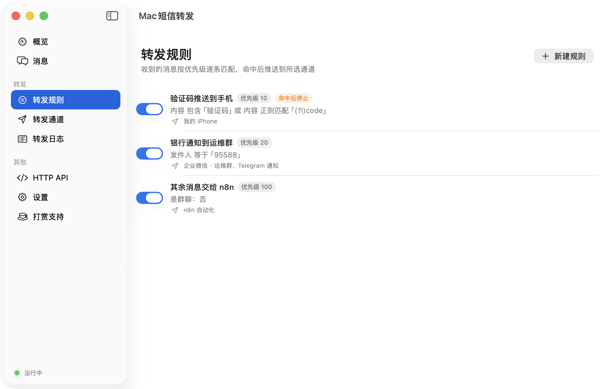
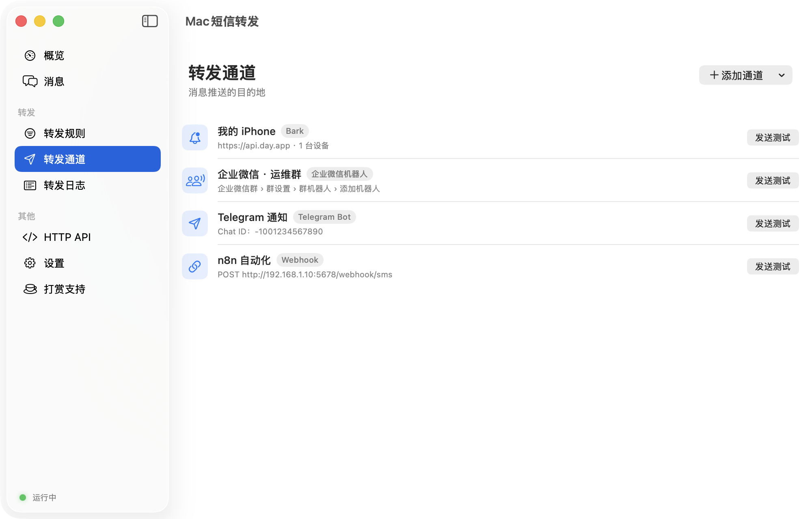
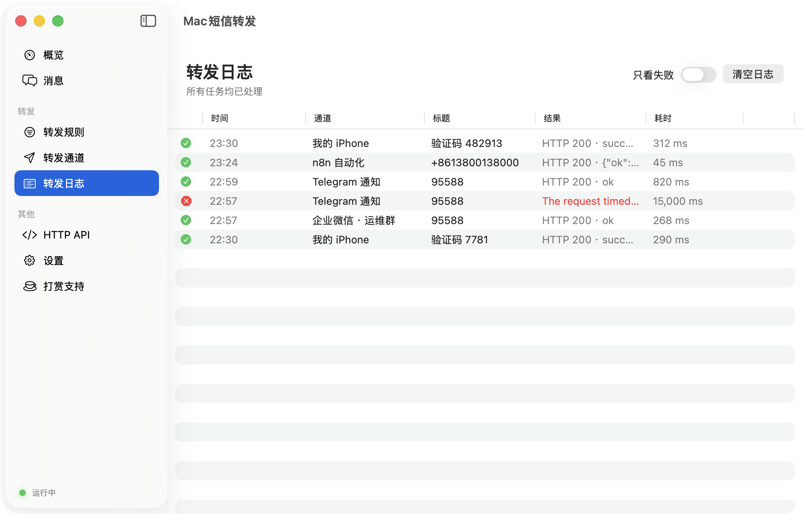
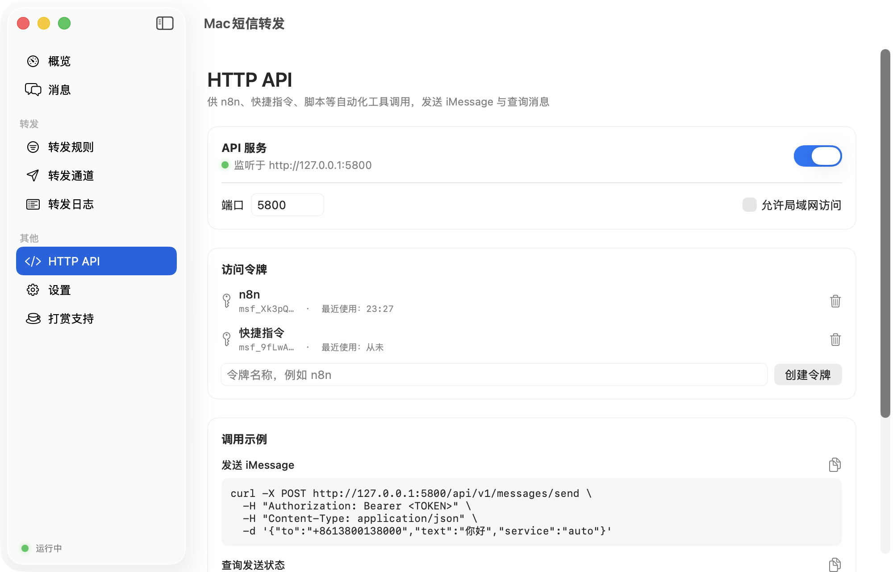
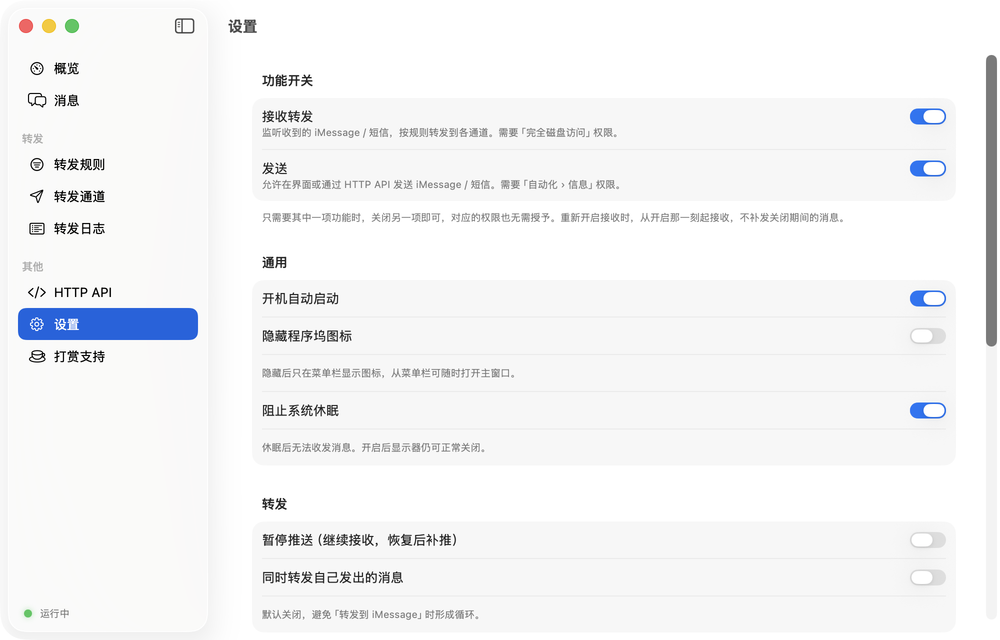
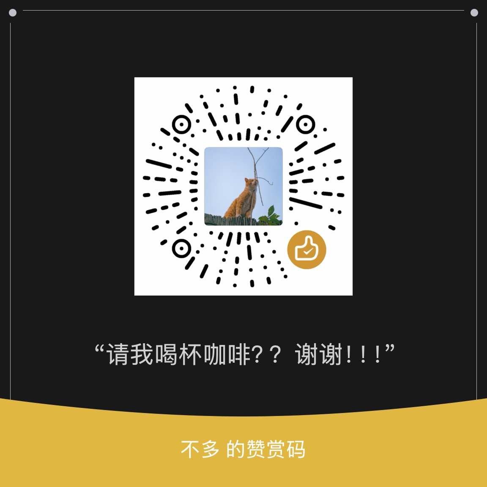

<div align="center">

# Mac短信转发 · MacSMSForwarder

**把 Mac 收到的 iMessage 与短信，自动转发到 Bark、企业微信、钉钉、飞书、Telegram 等 11 种通道；<br>并提供本地 HTTP API，让自动化工具免费发送 iMessage。**

[](https://github.com/0xYu4n/MacSMSForwarder/actions/workflows/ci.yml)
[](https://github.com/0xYu4n/MacSMSForwarder/releases)


[](LICENSE)

[下载](https://github.com/0xYu4n/MacSMSForwarder/releases) · [快速上手](#快速上手) · [HTTP API](#http-api) · [常见问题](#常见问题) · [English](#english)

</div>

---

## 为什么做这个

验证码、银行通知、快递短信都发到了 iPhone，但人常常在电脑前、或者想把它们接进自动化流程。Mac 的「信息」App 本来就能同步 iPhone 上的 iMessage 和短信，**Mac短信转发** 让这台 Mac 变成一个 24 小时在线的消息网关：

- 📥 **接收转发**：收到消息后按规则推送到你常用的通道，验证码自动提取
- 📤 **发送**：通过 HTTP API 发送 iMessage，给自动化脚本用，**不花一分短信费**
- 🔀 **两个功能独立开关**：只要其中一个，就只开一个，对应的系统权限也不用给

## 界面预览

<p align="center">
  
</p>

| 消息 | 转发规则 |
|---|---|
|  |  |
| **转发通道** | **转发日志** |
|  |  |
| **HTTP API** | **设置** |
|  |  |

> 截图中的号码与内容均为演示数据，可用 `scripts/screenshots.sh` 重新生成。

## 功能

| | |
|---|---|
| **实时收信** | 监听本机「信息」数据库，新消息秒级处理；首次启动不会转发历史消息 |
| **转发规则** | 按发件人、内容（包含 / 不包含 / 等于 / 开头 / 正则）、服务类型、群聊、附件组合匹配；支持优先级、「命中后停止」、一键用最近消息测试 |
| **验证码识别** | 自动提取 4–8 位验证码，模板中用 `{{code}}` 引用；Bark 推送时自动复制到 iPhone 剪贴板 |
| **11 种通道** | 见下表，新增通道只需写一个分支，配置表单自动生成 |
| **可靠投递** | 转发任务持久化，失败按 1 / 2 / 4 / 8… 分钟指数退避重试，App 重启后继续；每个通道可限速 |
| **HTTP API** | 发送、查询消息与送达状态、SSE 实时事件流；Bearer Token 鉴权，默认仅本机访问 |
| **后台发送** | 通过 Apple Events 驱动「信息」App，不模拟点击、**不需要关闭 SIP** |
| **省心常驻** | 菜单栏常驻、开机自启、阻止休眠、可隐藏程序坞图标、数据自动清理 |
| **版本更新** | 启动时自动检查 GitHub 最新版本（也可在「设置 › 关于」手动检查），有新版本时提示并一键打开下载页 |

### 支持的转发通道

| 分类 | 通道 | 特性 |
|---|---|---|
| 手机推送 | **Bark** | 多设备、分组、推送级别、自建服务器、验证码自动复制 |
| | **PushDeer** | 支持自建服务器 |
| | **Server酱** | 兼容 `SCT` 与新版 `sctp` SendKey |
| | **PushPlus** | 支持群组与指定渠道 |
| IM 机器人 | **企业微信群机器人** | 支持 @成员 |
| | **钉钉群机器人** | 支持加签、@成员 |
| | **飞书群机器人** | 支持签名校验 |
| | **Telegram Bot** | 支持自定义 API 反代地址 |
| 自建推送 | **ntfy** | 支持访问令牌、优先级 |
| | **Gotify** | 支持优先级 |
| 通用 | **Webhook** | 自定义方法、请求头、请求体模板（JSON 自动转义）、HMAC 签名，可接 n8n / Home Assistant 等 |

## 系统要求

- macOS 14 Sonoma 及以上（Apple 芯片与 Intel 均可）
- 「信息」App 已登录 Apple ID
- 需要收发**短信**（绿色气泡）时：iPhone 打开「设置 › 信息 › 短信转发」并勾选这台 Mac

## 安装

1. 从 [Releases](https://github.com/0xYu4n/MacSMSForwarder/releases) 下载最新的 `MacSMSForwarder-x.y.z.dmg`，把「Mac短信转发」拖进「应用程序」
2. 应用未经 Apple 公证，首次打开请在「应用程序」中**右键 › 打开**；若提示已损坏，在终端执行：

   ```bash
   xattr -dr com.apple.quarantine "/Applications/Mac短信转发.app"
   ```

3. 打开后按「概览」页提示授予权限（只需授予已开启功能对应的权限）：

   | 功能 | 需要的权限 | 位置 |
   |---|---|---|
   | 接收转发 | 完全磁盘访问权限 | 系统设置 › 隐私与安全性 › 完全磁盘访问权限 › `+` 添加本 App |
   | 发送 | 自动化 › 信息 | 首次发送时系统弹窗询问，点「允许」 |

以后有新版本发布时，App 启动后会自动提示，点「前往下载」即可打开下载页；不想更新某个版本可以选择「跳过此版本」。

> ⚠️ 由于应用未签名，**更新版本后系统可能会失效「完全磁盘访问权限」**。在列表中选中旧条目点 `−` 删除，再重新添加即可。

想尝鲜开发版？每次提交都会自动云编译，在 [Actions](https://github.com/0xYu4n/MacSMSForwarder/actions/workflows/ci.yml) 中打开最新一次成功的运行，在页面底部 Artifacts 下载。

## 快速上手

1. **转发通道 › 添加通道 › Bark**：填入设备 Key（Bark App 首页推送地址中 `api.day.app/` 后面那一段），点「发送测试」
2. **转发规则 › 新建规则**：勾选刚才的通道。不加条件即转发全部消息；也可以只转发「内容包含 验证码」的消息
3. 用另一台设备给这台 Mac（或配对的 iPhone）发条消息，几秒内就会收到推送

### 模板变量

规则的标题 / 正文模板，以及 Webhook 的 URL、请求头、请求体中都可以使用：

| 变量 | 说明 |
|---|---|
| `{{from}}` | 发件人号码或邮箱 |
| `{{text}}` | 消息正文 |
| `{{code}}` | 自动提取的验证码，没有则为空 |
| `{{service}}` | `iMessage` / `SMS` |
| `{{time}}` | 收到时间，例如 `2026-10-11 12:30:00` |
| `{{chat}}` | 会话 ID |
| `{{device}}` | 本机名称 |
| `{{title}}` `{{body}}` | 仅 Webhook：规则渲染后的标题与正文 |

## HTTP API

在「HTTP API」页开启服务（默认 `http://127.0.0.1:5800`）并创建令牌。所有接口需要请求头 `Authorization: Bearer <TOKEN>`。

| 方法 | 路径 | 说明 |
|---|---|---|
| `POST` | `/api/v1/messages/send` | 发送消息，返回 `202` 和消息 ID；发送功能关闭时返回 `503` |
| `GET` | `/api/v1/messages/{id}` | 查询消息与发送状态：`pending` / `sent` / `delivered` / `failed` |
| `GET` | `/api/v1/messages` | 消息列表，参数：`direction`、`handle`、`since`（ISO 8601）、`before_id`、`limit` |
| `GET` | `/api/v1/handles/{handle}/service` | 根据本机历史推断对方走 iMessage 还是短信 |
| `GET` | `/api/v1/events` | SSE 实时事件流：`message`、`send_status`、`forward` |
| `GET` | `/api/v1/health` | 运行状况与权限状态 |

```bash
# 发送 iMessage（service 可选 auto / imessage / sms，默认 auto）
curl -X POST http://127.0.0.1:5800/api/v1/messages/send \
  -H "Authorization: Bearer msf_xxx" \
  -H "Content-Type: application/json" \
  -d '{"to":"+8613800138000","text":"你好"}'

# 实时接收新消息（连接保持不断开，有消息时立即推送）
curl -N http://127.0.0.1:5800/api/v1/events -H "Authorization: Bearer msf_xxx"
```

<details>
<summary>SSE 事件示例</summary>

```
event: message
data: {"code":"482913","direction":"incoming","handle":"+8613800138000","service":"SMS","text":"您的验证码是 482913","date":"2026-10-11T04:30:00Z",...}
```

</details>

<details>
<summary>Webhook 签名校验</summary>

设置签名密钥后，请求会附带两个请求头：

- `X-Timestamp`：秒级时间戳
- `X-Signature`：`sha256=` + HMAC-SHA256(密钥, `时间戳 + "\n" + 请求体`) 的十六进制

接收端用同样的方式计算并比对，同时检查时间戳是否在允许范围内，即可防伪造与重放。

</details>

## 常见问题

<details>
<summary>收不到短信，只能收到 iMessage？</summary>

需要在 iPhone 打开「设置 › 信息 › 短信转发」并勾选这台 Mac，且 iPhone 保持开机联网。可以先在 Mac 的「信息」App 里确认能看到短信。
</details>

<details>
<summary>发给安卓号码失败？</summary>

iMessage 只能发给开通了 iMessage 的苹果用户。设置中开启「iMessage 失败时退回短信」后会改走短信（需要 iPhone 短信转发，按运营商资费计费）。
</details>

<details>
<summary>Mac 睡眠后就不转发了？</summary>

设置中开启「阻止系统休眠」（默认开启）。合上笔记本盖子仍会休眠，建议用一台常开的 Mac 或 Mac mini。
</details>

<details>
<summary>会不会被 Apple 封号？</summary>

正常的个人通知、验证码转发不会有问题。请勿用于群发、营销或骚扰，否则 Apple ID 的 iMessage 功能可能被限制。
</details>

<details>
<summary>数据存在哪里？安全吗？</summary>

所有数据只保存在本机 `~/Library/Application Support/MacSMSForwarder/`，目录仅当前用户可读，不经过任何第三方服务器（除了你自己配置的推送通道）。API 默认只监听 `127.0.0.1`。
</details>

## 从源码编译

只需要 Xcode 命令行工具（`xcode-select --install`），不需要完整的 Xcode：

```bash
git clone https://github.com/0xYu4n/MacSMSForwarder.git
cd MacSMSForwarder
scripts/build-app.sh --run              # 编译、组装 dist/Mac短信转发.app 并启动
scripts/build-app.sh --universal --dmg  # 通用二进制 + DMG 安装包
scripts/test.sh                         # 运行单元测试
scripts/screenshots.sh                  # 用演示数据重新生成 README 截图
```

### 项目结构

```
Sources/
├── ForwarderCore/        核心逻辑（不依赖界面，便于测试）
│   ├── Ingest/           收信：监听 chat.db → 去重入库 → 规则匹配
│   ├── Rules/            规则引擎、模板渲染、验证码提取
│   ├── Channels/         转发通道（Bark、Webhook、ParamChannels 及 ChannelCatalog）
│   ├── Forward/          持久化转发队列与重试
│   ├── Send/             发送与送达状态跟踪
│   ├── Server/           HTTP API 与 Token 管理
│   ├── Storage/          GRDB 数据库与迁移
│   └── System/           权限检测、开机自启、防休眠
└── MacSMSForwarder/      SwiftUI 界面与菜单栏
tests/                    单元测试
scripts/                  打包、图标生成、测试脚本
```

### 新增一个转发通道

1. 在 `ChannelType` 中加一个 case
2. 在 `ChannelCatalog.fields(for:)` 中声明配置字段（界面表单自动生成）
3. 在 `ParamChannel.makeRequest` 中构造请求，在 `evaluate` 中判断成功
4. 在 `tests/` 中补一个请求构造测试

欢迎提交 PR！

## 工作原理

- **收信**：只读打开 `~/Library/Messages/chat.db`，基于 [imsg](https://github.com/openclaw/imsg) 的 `IMsgCore` 监听新增消息并解析正文
- **发送**：`IMsgCore` 通过 AppleScript 驱动「信息」App 在后台发送，再回查 `chat.db` 跟踪送达状态
- **存储**：自有 SQLite 数据库（[GRDB](https://github.com/groue/GRDB.swift)），记录消息、规则、通道、转发任务与日志

## 打赏支持

如果这个项目对你有帮助，欢迎请作者喝杯咖啡 ☕（App 内「打赏支持」页也可以扫码）：



点一颗 ⭐ Star、提交 Issue 反馈问题，也是对项目很大的鼓励。

## 免责声明

本项目与 Apple Inc. 无任何关联。请遵守当地法律法规与各推送平台的使用条款，勿用于群发、营销或任何违法用途。

## 许可

[MIT](LICENSE)。第三方组件见 [THIRD_PARTY_NOTICES](THIRD_PARTY_NOTICES)。

---

## English

**MacSMSForwarder** turns your Mac into an iMessage / SMS gateway:

- **Forward** incoming iMessages and SMS (via iPhone Text Message Forwarding) to Bark, WeCom, DingTalk, Feishu, Telegram, PushDeer, ServerChan, PushPlus, ntfy, Gotify or any webhook, with rule matching and automatic OTP extraction.
- **Send** iMessages for free through a local HTTP API (Bearer token, SSE event stream).
- Receiving and sending can be **enabled independently**; each only needs its own permission (Full Disk Access for receiving, Automation › Messages for sending).
- Native SwiftUI, menu-bar resident, no SIP changes required. macOS 14+.

Download the latest DMG from [Releases](https://github.com/0xYu4n/MacSMSForwarder/releases). The app is not notarized: right-click › Open on first launch, or run `xattr -dr com.apple.quarantine "/Applications/Mac短信转发.app"`.
